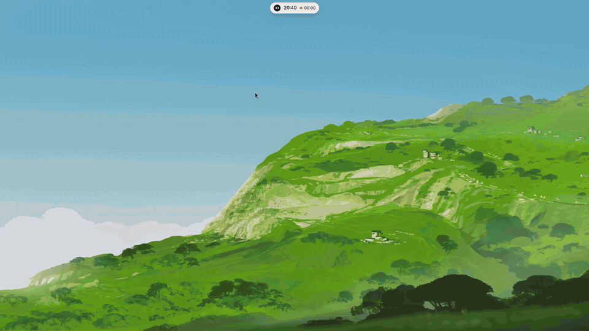

<p align="center">
  
</p>

<h1 align="center">Minimo OS</h1>

<p align="center">Hyprland minimalista para Arch Linux: una isla dinámica flotante y Minimo, un personaje que reacciona a lo que hacés.</p>

<p align="center">
  <a href="https://github.com/Diegolede/minimo-os/releases/latest"></a>
  <a href="LICENSE"></a>
  
  
  
</p>

<p align="center">
  <a href="https://diegolede.github.io/minimo-os-web/">Sitio web</a>
  &nbsp;·&nbsp;
  <a href="https://github.com/Diegolede/minimo-os/releases">Releases</a>
  &nbsp;·&nbsp;
  <a href="minimo-shell/CHANGELOG.md">Novedades</a>
</p>

<p align="center">
  <a href="https://github.com/Diegolede/minimo-os/releases/download/v1.1.1-beta/minimo-os-demo.mp4"></a>
</p>

---

## Contenido

- [Descripción](#descripción)
- [Características](#características)
- [Requisitos](#requisitos)
- [Instalación](#instalación)
- [Actualización](#actualización)
- [Desinstalación](#desinstalación)
- [Atajos de teclado](#atajos-de-teclado)
- [Configuración](#configuración)
- [Estructura del proyecto](#estructura-del-proyecto)
- [Novedades](#novedades)
- [Créditos](#créditos)
- [Licencia](#licencia)

## Descripción

Minimo OS es una configuración completa de escritorio para Arch Linux sobre Hyprland (configuración
en Lua), con una shell propia escrita en Quickshell (QML). Toda la interfaz vive en una sola isla
flotante en la parte superior de la pantalla, acompañada por Minimo: una esfera negra con ojos que
siguen al mouse. Incluye además una pantalla de inicio propia (greetd), la configuración de la
terminal Ghostty y un instalador de una sola línea.

El diseño es blanco y negro, sin adornos, y prioriza el bajo consumo: la shell reacciona a eventos
en lugar de hacer sondeos periódicos y pausa sus animaciones durante la inactividad.

## Características

### Isla dinámica

- Hora, escritorios y estado en una píldora compacta que se oculta sola y aparece al acercar el mouse.
- Menú con buscador, música, volumen, brillo, saturación y accesos rápidos; los elementos se pueden fijar y reordenar desde Ajustes.
- Gestos: deslizar a la derecha muestra los recursos del sistema (internet, batería, CPU, memoria, disco y dispositivos); a la izquierda, las apps en segundo plano de la bandeja del sistema; hacia abajo, la mascota. La rueda del mouse cambia de escritorio.
- Notificaciones con servidor propio, cola y acciones; se pausan al pasar el mouse.
- Portapapeles con historial, imágenes y elementos fijados (`Super + V`).
- Notas, calendario del mes y selector de emojis con categorías, búsqueda y tono de piel.
- Escritorios: arrastrar una app a otro escritorio, cerrarla o enfocarla con un clic.
- Wi-Fi con la red actual, la señal y las redes cercanas.

### Minimo

- Personaje animado: parpadea, respira, mira al cursor, reacciona al abrir la isla y baila con la música.
- Se duerme cuando el equipo queda inactivo y despierta al volver a usarlo.
- Modo mascota con comida, ánimo y energía, y avisos de hambre, aburrimiento y sueño; se puede apagar en Ajustes.

### Capturas y grabación

- Captura de un área o de la pantalla completa, guardada en `~/Imágenes/Capturas` y copiada al portapapeles, con vista previa grande en la isla.
- Grabación de pantalla con audio del sistema (wf-recorder) en la carpeta `Grabaciones` dentro de Vídeos.

### Escritorio

- Lanzador de aplicaciones navegable con el teclado (`Super + B`).
- Vista de ventanas estilo Exposé (`Super + Tab`).
- Reproductor con carátula circular que gira mientras suena la música.
- Fondos de pantalla, incluido fondo animado (video o GIF) que se pausa con ventanas encima o en inactividad.
- Modo oscuro.
- Diálogo de contraseña (polkit) con los colores, la fuente y el redondeo de Minimo.
- Iconos Fluent UI System Icons (Filled).

### Ajustes

- Personalización, pantalla (resolución, frecuencia y escala con confirmación), idioma español o inglés, atajos generados desde la configuración real con buscador, gestos de la isla con ilustraciones y actualizaciones.

### Pantalla de inicio

- Basada en greetd, cage y Quickshell: Minimo en el inicio de sesión, aviso de Bloq Mayús, mostrar contraseña, selector de sesión, apagado y reinicio con confirmación y desbloqueo del llavero de GNOME.

## Requisitos

- Arch Linux, con un usuario normal que tenga permisos de `sudo`.
- Hyprland 0.56 o superior (configuración en Lua).
- Paquetes de los repositorios oficiales (el instalador los instala):

  ```
  hyprland xdg-desktop-portal-hyprland hyprpolkitagent quickshell qt6-declarative qt6-svg
  qt6-wayland pipewire pipewire-pulse wireplumber cava playerctl ghostty grim slurp wf-recorder
  zenity adwaita-fonts noto-fonts-emoji networkmanager wl-clipboard cliphist gnome-keyring
  python lua git
  ```

- Opcionales: `fuzzel` (`Super + Espacio`), `github-cli` y `pacman-contrib` (`checkupdates`, para
  comprobar los paquetes del sistema en Ajustes › Actualizaciones). `mpvpaper` (AUR) para el fondo animado.
- El instalador ofrece instalar el navegador Helium (`helium-browser-bin`, AUR).

## Instalación

En una sola línea:

```bash
curl -fsSL https://raw.githubusercontent.com/Diegolede/minimo-os/main/install.sh | bash
```

El instalador clona el proyecto en `~/Proyectos/minimo-os` y continúa desde ahí; las preguntas se
responden en la terminal. También se puede instalar a mano:

```bash
git clone https://github.com/Diegolede/minimo-os.git ~/Proyectos/minimo-os
~/Proyectos/minimo-os/install.sh
```

> [!IMPORTANT]
> Ejecutá `install.sh` (y `greeter/install-greeter.sh`) con tu usuario normal, **sin `sudo`**. Los
> scripts piden la contraseña de administrador cuando la necesitan y se detienen si se ejecutan como root.

### Opciones

| Opción | Efecto |
|---|---|
| `--dry-run` | Muestra cada paso sin cambiar nada. |
| `--yes` | No hace preguntas. |
| `--no-greeter` | Conserva el gestor de sesión actual (GDM, SDDM...) en lugar de la pantalla de inicio de Minimo. |
| `--preview` | Muestra la interfaz del instalador sin comprobar ni cambiar nada. |

Con la instalación en una línea, las opciones se pasan así:

```bash
curl -fsSL https://raw.githubusercontent.com/Diegolede/minimo-os/main/install.sh | bash -s -- --no-greeter
```

### Qué hace

- Instala los paquetes y los marca como instalados explícitamente.
- Respalda `~/.config/hypr` en `~/.config/hypr.bak-<fecha>` y enlaza la configuración del repositorio, de modo que un `git pull` la actualiza.
- Copia `minimo/monitores.lua` una sola vez (es propio de cada equipo) y los fondos a `~/Imágenes/Fondos`.
- Ofrece instalar Helium e instala la configuración de Ghostty y el saludo de Minimo en la terminal.
- Habilita los servicios de usuario `minimo-shell`, `minimo-clipboard` y `hyprpolkitagent`.
- Instala la pantalla de inicio (salvo con `--no-greeter`): respalda `/etc/greetd/config.toml`, desactiva el gestor actual sin detenerlo y activa greetd. Se ve al reiniciar.

El instalador es idempotente: se puede volver a ejecutar sin romper nada.

Si la pantalla de inicio no arranca, cambiá a otra consola con `Ctrl + Alt + F3`, entrá con tu
usuario y volvé al gestor anterior:

```bash
sudo systemctl disable greetd && sudo systemctl enable gdm && sudo reboot
```

Más detalles en [greeter/README.md](greeter/README.md).

## Actualización

**Ajustes › Actualizaciones** muestra la versión instalada, comprueba si hay versiones nuevas en
GitHub y muestra las novedades. Para actualizar:

```bash
git -C ~/Proyectos/minimo-os pull --ff-only && ~/Proyectos/minimo-os/install.sh
```

`git pull --ff-only` no pisa cambios locales: se detiene si no puede avanzar.

## Desinstalación

```bash
~/Proyectos/minimo-os/uninstall.sh
```

Desactiva la shell, quita los enlaces de la terminal y restaura el último respaldo de
`~/.config/hypr`. No desinstala paquetes ni borra fondos. Acepta `--dry-run` y `--yes`. Si la
pantalla de inicio está activa, el script indica cómo volver al gestor anterior.

## Atajos de teclado

`Super` es la tecla principal. La lista completa, con buscador, está en **Ajustes › Atajos**.

| Atajo | Acción |
|---|---|
| `Super + T` | Terminal (Ghostty) |
| `Super + B` | Lanzador de aplicaciones |
| `Super + Espacio` | fuzzel (opcional) |
| `Super + X` | Abrir la isla |
| `Super + V` | Historial del portapapeles |
| `Super + Tab` | Vista de ventanas |
| `Super + ,` | Ajustes |
| `Super + Shift + R` | Iniciar o detener la grabación de pantalla |
| `Impr Pant` | Captura de un área |
| `Ctrl + Impr Pant` | Captura de la pantalla completa |
| `Super + Q` | Cerrar ventana |
| `Super + F` | Maximizar |
| `Super + Shift + F` | Pantalla completa |
| `Super + Shift + T` | Ventana flotante |
| `Super + W` | Agrupar ventanas |
| `Super + R` | Alternar división |
| `Super + Flechas` o `H J K L` | Mover el foco |
| `Super + Shift + Flechas` o `H J K L` | Mover la ventana |
| `Super + Ctrl + Flechas` | Foco en otro monitor |
| `Super + Shift + Ctrl + Flechas` | Mover la ventana a otro monitor |
| `Super + -` / `Super + =` | Redimensionar en horizontal (`Shift`: en vertical) |
| `Super + clic izquierdo` / `derecho` | Mover / redimensionar con el mouse |
| `Super + 1` ... `9` | Ir al escritorio |
| `Super + Shift + 1` ... `9` | Mover la ventana al escritorio |
| `Super + Re Pág` / `Av Pág` (o `I` / `U`) | Escritorio anterior / siguiente |
| `Super + rueda del mouse` | Escritorio anterior / siguiente |
| `Super + Shift + P` | Encender o apagar la pantalla |
| `Super + Shift + E` | Salir de Hyprland |

Las teclas multimedia (volumen, silencio, micrófono, reproducir, siguiente y anterior) funcionan
también con la pantalla bloqueada. Los atajos están en [hypr/minimo/atajos.lua](hypr/minimo/atajos.lua)
y [hypr/minimo.lua](hypr/minimo.lua).

## Configuración

Lo habitual se cambia desde **Ajustes** (botón en la isla o `Super + ,`):

- **Personalización:** fondo de pantalla, idioma, ocultar la isla automáticamente, personaje animado, mascota y tiempo para dormir.
- **Pantalla:** resolución, frecuencia y escala por monitor (se revierte en 15 s si no se confirma), brillo y saturación.
- **Atajos, Gestos, Actualizaciones y Acerca de.**

El estado se guarda en `~/.config/minimo-os/state.json`. La configuración de Hyprland está en
[hypr/](hypr) y se puede editar directamente.

La shell también se controla por IPC, útil para atajos propios:

```bash
qs -p ~/Proyectos/minimo-os/minimo-shell ipc call launcher toggle
qs -p ~/Proyectos/minimo-os/minimo-shell ipc call settings toggle
qs -p ~/Proyectos/minimo-os/minimo-shell ipc call recorder toggle
qs -p ~/Proyectos/minimo-os/minimo-shell ipc call character list
```

## Estructura del proyecto

| Ruta | Contenido |
|---|---|
| [install.sh](install.sh) / [uninstall.sh](uninstall.sh) | Instalación y desinstalación |
| [hypr/](hypr) | Configuración de Hyprland en Lua: apariencia, entrada, monitores, reglas y atajos |
| [minimo-shell/](minimo-shell) | Shell en Quickshell (QML): isla, personaje, lanzador, vista de ventanas, ajustes y fondo |
| [greeter/](greeter) | Pantalla de inicio (greetd + cage + Quickshell) |
| [terminal/](terminal) | Configuración de Ghostty y saludo de Minimo |
| [systemd/](systemd) | Servicios de usuario de la shell y del portapapeles |
| [assets/](assets) | Icono y fondos por defecto |
| [docs/](docs) | Video de demostración |
| [tests/](tests) | Pruebas |

## Novedades

El historial de cambios está en [minimo-shell/CHANGELOG.md](minimo-shell/CHANGELOG.md)
([English](minimo-shell/CHANGELOG.en.md)) y en
[Releases](https://github.com/Diegolede/minimo-os/releases).

## Créditos

- Iconos: [Fluent UI System Icons](https://github.com/microsoft/fluentui-system-icons) de Microsoft,
  licencia MIT ([minimo-shell/assets/icons/fluent/LICENSE](minimo-shell/assets/icons/fluent/LICENSE)).
- Navegador: [Helium](https://aur.archlinux.org/packages/helium-browser-bin), instalado desde AUR.
- Construido sobre [Hyprland](https://hyprland.org) y [Quickshell](https://quickshell.org).

Creado por **TRN1 (Diego Ledesma)**.

## Licencia

Distribuido bajo la licencia [MIT](LICENSE). © 2026 Diego Ledesma (TRN1).
